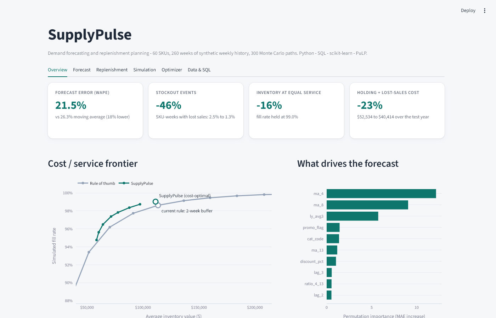

# SupplyPulse

Inventory forecasting and replenishment planning. SupplyPulse predicts weekly demand per SKU, recommends reorder
quantities, and proves the policy with a Monte Carlo inventory simulation. Planners get a local dashboard, an Excel
what-if model with live formulas, and a Power BI-ready data model.

**Stack:** Python, SQL (SQLite window functions), scikit-learn, PuLP (MILP), Streamlit, Excel (openpyxl), Power BI.



## Quick start

Requires Python 3.10+ (developed on 3.14).

```bash
git clone https://github.com/DevFrancisA/supplypulse && cd supplypulse
python -m venv .venv
.venv\Scripts\activate            # macOS / Linux: source .venv/bin/activate
pip install -r requirements.txt

streamlit run app/app.py          # opens the dashboard at http://localhost:8501
```

Pre-computed results ship in `outputs/`, so the app opens instantly. To regenerate everything from scratch (about 10 seconds):

```bash
python -m supplypulse.pipeline
python -m pytest -q               # 22 tests
```

## What you get

| Deliverable | Where |
|---|---|
| Local dashboard (6 tabs: overview, forecast, replenishment, simulation, live optimiser, SQL console) | `streamlit run app/app.py` |
| Excel what-if model, all live formulas (service level, demand uplift, supplier delay) | `outputs/SupplyPulse_WhatIf_Model.xlsx` |
| Power BI data model, DAX measures, theme | `powerbi/` |
| Weekly replenishment plan (CSV) | `outputs/recommendations.csv` |
| SQLite database with sales, forecasts and plans | `outputs/supplypulse.db` (created by the pipeline) |

## Results (seed 42, 60 SKUs, 5 years of weekly history)

Measured on a held-out final year the models never trained on.

| Metric | Rule of thumb | SupplyPulse |
|---|---|---|
| Forecast error (WAPE) | 26.3% (4-week moving average) | **21.5%** (18% lower) |
| WAPE in promo weeks | 35.7% | **23.2%** |
| Stockout events (share of SKU-weeks with lost sales) | 2.47% | **1.35%** (46% fewer; 5-95% range 32-58%) |
| Lost units | 3,271 | **2,300** (30% fewer) |
| Fill rate | 98.6% | **99.0%** |
| Average inventory at the *same* fill rate | | **16% lower** |
| Holding + lost-sales cost | $52,534 | **$40,414** (23% lower) |

How to read these honestly:

* **The data is synthetic.** It has category seasonality, trend, promotions with lift and post-promo dips, and
  over-dispersed noise, so the forecasting problem is non-trivial, but the numbers say nothing about a real business.
* **The baseline is a rule of thumb**, not the best possible heuristic: order up to the 4-week average times
  (lead time + 1 + 2 weeks of flat buffer). Because one buffer is arbitrary, the app sweeps the buffer from 0 to 6 weeks and
  plots a **cost / service frontier**; the "16% less inventory" figure compares against the rule-of-thumb buffer that gives
  the same simulated fill rate. At the fixed 2-week buffer alone, inventory is only 1.9% lower; the gain there is mostly
  fewer stockouts.
* The optimiser's analytic fill rate (99.8%) is optimistic against the simulated one (99.0%): a normal-error model
  understates skew, MOQ effects and multi-step forecast error. The simulation is the arbiter.

## How it works

```
data.py ──► SQLite ──► features.sql ──► forecast.py ──► optimize.py ──► simulate.py
 synthetic   skus,       window-function   HistGradient-    PuLP MILP:     Monte Carlo,
 demand      weekly_     lags / rolling    Boosting vs.     z per SKU      300 paths x 60 SKUs
             sales       means (no leak)   4-wk average                    x 52 weeks x 2 policies
                                                │                              │
                                                └────────► recommendations ◄───┘
                                                                │
                                         Excel what-if · Power BI model · Streamlit app
```

1. **Data** (`supplypulse/data.py`). Generates demand with a negative-binomial noise model; the true mean is kept
   in a separate oracle file used only to draw simulation paths, never as a model input.
2. **SQL features** (`supplypulse/sql/features.sql`). Lags (1-4, 8, 52), rolling means, rolling promo rate and a same-week-
   last-year average, all with windows ending at `1 PRECEDING`. A test perturbs the future and asserts past features do not move.
3. **Forecast** (`supplypulse/forecast.py`). A global `HistGradientBoostingRegressor` with Poisson loss, trained with
   expanding windows: a *calibration* fold (estimates forecast error for safety stock) and a *test* fold (reported accuracy).
   Multi-week forecasts are produced recursively through the same SQL feature query.
4. **Optimiser** (`supplypulse/optimize.py`). Each SKU picks one service level z from a grid. The MILP minimises
   holding cost of safety stock plus expected lost-sales cost (normal loss function), subject to a demand-weighted fill-rate
   floor and a per-SKU floor. Sigma is the error of the (lead time + 1)-week cumulative forecast measured on the calibration
   fold, so multi-step error is included. Works with PuLP 2.x/3.x (CBC) and 4.x (HiGHS).
5. **Simulation** (`supplypulse/simulate.py`). Weekly review, order-up-to policy, lost sales, case packs, MOQs and
   per-SKU lead times of 1-4 weeks. Both policies see identical demand paths. Includes a stock-flow identity test.
6. **Excel model** (`supplypulse/excel_model.py`). Every output cell is a formula over named input cells. Recalculating the
   workbook with an independent engine reproduces the Python order quantities exactly.

## Project layout

```
app/app.py                  Streamlit dashboard
supplypulse/                package: data, features, forecast, optimize, simulate, whatif, excel_model, powerbi, pipeline
supplypulse/sql/            schema, feature query, ABC classification
tests/                      22 tests: leakage, accuracy, stock-flow identity, optimiser constraints, Excel formulas
outputs/                    pipeline results (CSV, JSON, Excel); regenerate any time
powerbi/                    star-schema CSVs, DAX measures, theme, build guide
data/                       generated raw data (skus, weekly sales, simulation oracle)
```

## Using your own data

Replace `data.generate()` with a loader that returns the same three frames: `skus`
(`sku_id, category, supplier, unit_cost, unit_price, lead_time_weeks, case_pack, moq`), `weekly_sales`
(`sku_id, week_idx, week_start, units, price, promo_flag, discount_pct`) and a `truth` frame. If you have no oracle, set
`truth.true_mean` to the model forecast so the simulation draws noise around it. Everything downstream is data-agnostic.

## Limitations

* Single-echelon, single location; lost sales (no backorders); no supplier capacity or transport constraints.
* Safety stock assumes roughly normal forecast error; skewed or intermittent demand will be under-protected (see above).
* Planned future promotions are optional inputs to the recursive forecast (`forecast_future(planned_promos=...)`); none are assumed by default.
* The Power BI report must be assembled in Power BI Desktop from `powerbi/` (about 10 minutes, steps in `powerbi/README.md`).

## License

MIT
